<div align="center">


<a href="https://github.com/gamefreefire24cc-sketch">
  
</a>

<p>
  
  
  
  
</p>


<br/>


<br/>
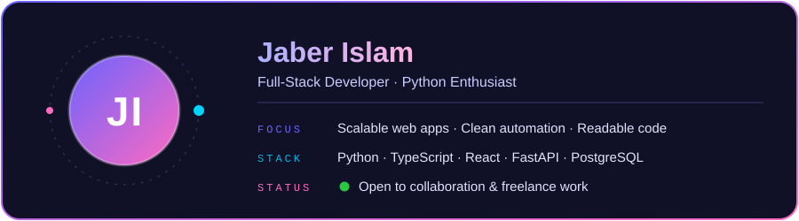
<br/><br/>

<br/><br/>

<br/>

</div>

<table width="100%">
<tr>
<td width="55%" valign="top">

> *"Clean code always looks like it was written by someone who cares."*

I'm a **full-stack developer** who builds scalable web applications, functional mobile apps and clean Python automation. I care about readable code, solid architecture and shipping things that actually work.

- 🔭 Building end-to-end full-stack applications
- 🌱 Exploring modern tooling, performance and developer experience
- 💬 Ask me about **Python, JavaScript/TypeScript and backend architecture**
- ⚡ I automate the boring stuff to focus on the interesting stuff
- 🤝 Open to collaboration and freelance work

</td>
<td width="45%" valign="top">

```python
class JaberIslam:
    role = "Full-Stack Developer"
    languages = ["Python", "JS/TS", "Go"]
    focus = ["Scalable APIs", "Clean UI"]
    motto = "Ship clean, ship fast"

    def get_to_work(self):
        return "Let's build something great!"
```

</td>
</tr>
</table>

<div align="center">

<br/>

<br/>
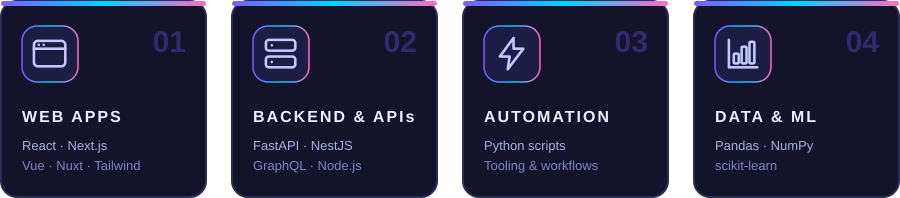

<br/>

<br/>
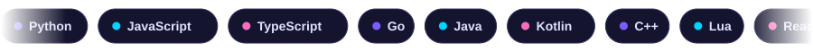
<br/>

**Languages**<br/>


**Frontend**<br/>


**Backend & APIs**<br/>


**Databases & DevOps**<br/>


**Data & Machine Learning**<br/>


<br/>
<br/>

<br/>

<br/>

<br/>

<br/>

<br/>

<br/>

<a href="https://github.com/gamefreefire24cc-sketch/repo-one"></a>
<a href="https://github.com/gamefreefire24cc-sketch/repo-two"></a>
<a href="https://github.com/gamefreefire24cc-sketch/repo-three"></a>

<br/>
<br/>


<br/>

<br/>


<br/>


<br/><br/>

<br/>


<br/><br/>

<br/><br/>

<picture>
  <source media="(prefers-color-scheme: dark)" srcset="https://raw.githubusercontent.com/gamefreefire24cc-sketch/gamefreefire24cc-sketch/output/github-contribution-grid-snake-dark.svg" />
  <source media="(prefers-color-scheme: light)" srcset="https://raw.githubusercontent.com/gamefreefire24cc-sketch/gamefreefire24cc-sketch/output/github-contribution-grid-snake.svg" />
  
</picture>

<br/><br/>

<br/>

<br/>

<a href="mailto:mdjaberulislam52@gmail.com"></a>
<a href="https://github.com/gamefreefire24cc-sketch"></a>

<br/><br/>


</div>
